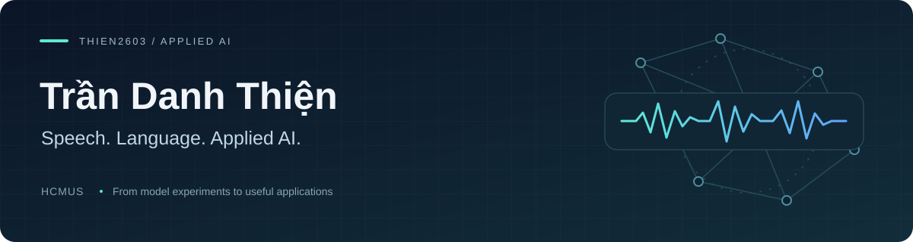

  

  <strong>Building practical AI systems for Vietnamese speech and language.</strong> 
  HCMUS · Model training &amp; evaluation · APIs &amp; applications

  <a href="https://github.com/thien2603?tab=repositories">Explore my repositories</a>
  &nbsp; / &nbsp;
  <a href="https://huggingface.co/Thien2603/tempoqr-models">TempoQR model artifacts</a>

### About my work

I work on Vietnamese ASR, language models and information retrieval. My projects also explore computer vision and recommendation systems, connecting model experiments with APIs and usable applications.

- **Speech & language:** medical speech recognition, PhoBERT fine-tuning and parameter-efficient learning.
- **Retrieval & reasoning:** dense retrieval, re-ranking and question answering over temporal knowledge graphs.
- **Applied systems:** multi-camera detection and tracking, hybrid search and recommendation APIs.

### Selected projects

<table>
  <tr>
    <td width="50%" valign="top">
      <h3>01 / Medical Speech Recognition</h3>
      
Vietnamese medical ASR with separate training, dataset evaluation and audio/video workflows. Compares FastConformer, PhoWhisper and Whisper using WER, CER and processing time.

      
<code>ASR</code> <code>NeMo</code> <code>Transformers</code>

      <a href="https://github.com/thien2603/ASR-Medical-Speech-To-Text">View project →</a>
    </td>
    <td width="50%" valign="top">
      <h3>02 / Vietnamese Sentiment &amp; PEFT</h3>
      
Experiments comparing full fine-tuning and LoRA for three-class Vietnamese sentiment classification with PhoBERT, examining accuracy, training time and trainable parameters.

      
<code>PhoBERT</code> <code>LoRA</code> <code>PEFT</code>

      <a href="https://github.com/thien2603/Vietnamese-Sentiment-PEFT">View project →</a>
    </td>
  </tr>
  <tr>
    <td width="50%" valign="top">
      <h3>03 / Traditional Medicine Retrieval</h3>
      
A Vietnamese traditional medicine chatbot project exploring dense retrieval, re-ranking and evidence display.

      
<code>Retrieval</code> <code>Re-ranking</code> <code>Vietnamese NLP</code>

      <a href="https://github.com/thien2603/Vietnamese-Traditional-Medicine-Chatbot-with-Dense-Retrieval-Re-Ranking-and-Evidence-Display">View project →</a>
    </td>
    <td width="50%" valign="top">
      <h3>04 / TempoQR</h3>
      
Evaluation and prediction workflows for temporal knowledge graph question answering, with English and Vietnamese support and a FastAPI interface.

      
<code>Knowledge Graphs</code> <code>PyTorch</code> <code>FastAPI</code>

      <a href="https://github.com/thien2603/TempoQR-">View project →</a>
    </td>
  </tr>
  <tr>
    <td width="50%" valign="top">
      <h3>05 / Multi-camera Detection &amp; Tracking</h3>
      
YOLO-based vehicle detection, per-camera tracking, line counting, region alerts and event APIs, with RTSP output and Docker deployment.

      
<code>Computer Vision</code> <code>YOLO</code> <code>Docker</code>

      <a href="https://github.com/thien2603/Detect-and-Tracking">View project →</a>
    </td>
    <td width="50%" valign="top">
      <h3>06 / Reco4Student</h3>
      
Second-hand product discovery for students using vector and text hybrid search, collaborative filtering and recommendation APIs on MongoDB Atlas.

      
<code>Recommendation</code> <code>MongoDB</code> <code>FastAPI</code>

      <a href="https://github.com/thien2603/Reco4Student-Project">View project →</a>
    </td>
  </tr>
</table>

### Tools I work with

| Models & experiments | Applications & tooling |
| :--- | :--- |
| Python · PyTorch · Hugging Face Transformers | FastAPI · Docker · Git |
| NeMo · PhoBERT · LoRA / PEFT | MongoDB Atlas · Jupyter · Kaggle |

---

Speech · Language · Retrieval · Vision

